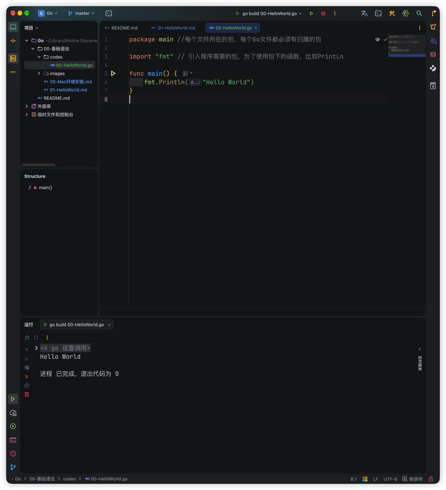

# 00-编写如下程序

> 00-HelloWorld.go

```go
package main //每个文件所在的包，每个Go文件都必须有归属的包

import "fmt"  // 引入程序需要的包，为了使用包下的函数，比如PrintLn

func main() {  //main主函数，程序的入口
	fmt.Println("Hello World")  // 在控制台打印
}
```

## 对源文件进行编译：

```sh
❯ ls
00-HelloWorld.go

❯ go build 00-HelloWorld.go 

❯ ls
00-HelloWorld           00-HelloWorld.go
```

## 执行操作

```sh
❯ ./00-HelloWorld
Hello World
```

## 也可以直接编译并运行

```sh
❯ go run 00-HelloWorld.go
Hello World
```




