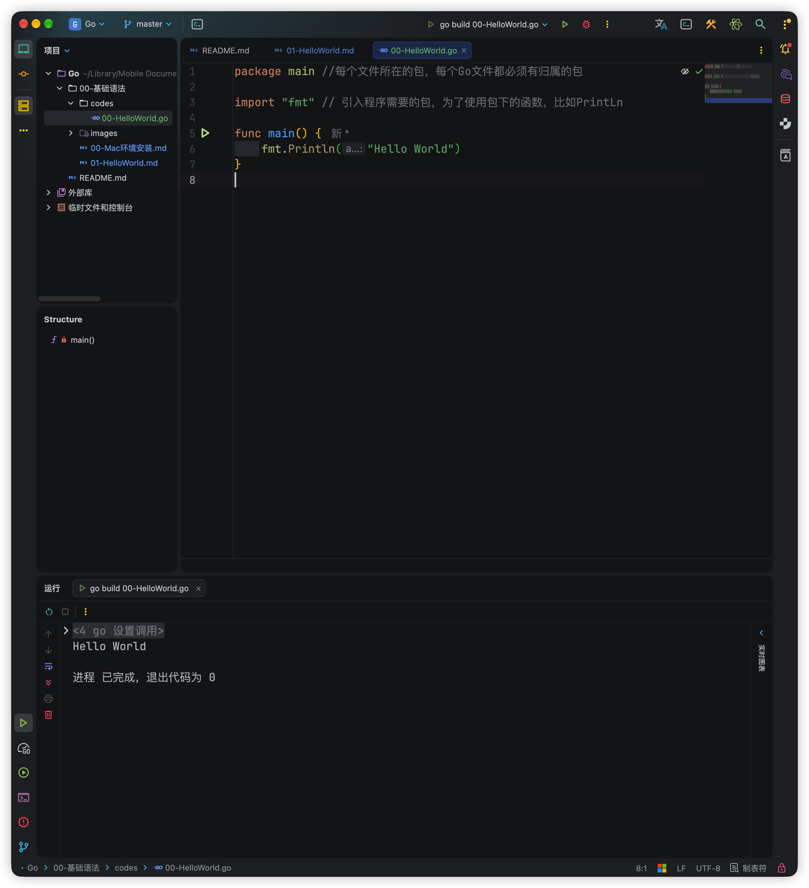

# 00-编写如下程序

> 00-HelloWorld.go

```go
package main //每个文件所在的包，每个Go文件都必须有归属的包

import "fmt"  // 引入程序需要的包，为了使用包下的函数，比如PrintLn

func main() {  //main主函数，程序的入口
	fmt.Println("Hello World")  // 在控制台打印
}
```

## 对源文件进行编译：

```sh
❯ ls
00-HelloWorld.go

❯ go build 00-HelloWorld.go 

❯ ls
00-HelloWorld           00-HelloWorld.go
```

## 执行操作

```go
❯ ./00-HelloWorld
Hello World
```

## 也可以直接编译并运行

```go
❯ go run 00-HelloWorld.go
Hello World
```




# 01-语法注意事项

1. 源文件以“go”为扩展名
2. 程序的执行入口是main()函数
3. 严格区分大小写
4. 方法由一条条语句构成，每个语句后不需要分号（Go语言会在每行后自动加分好），这也体现出Go语言的简洁性
5. 定义的变量或者import包如果没有使用到，代码不能编译通过
6. 大括号都是成对出现的，缺一不可

# 02-代码风格

1. 注意缩进

   1. 向后缩进：tab

   2. 向前取消缩进： shift+tab

   3. 通过命令完成格式化操作： 

      1. ```go
          gofmt 00-HelloWorld.go  //只是效果展示，不会写到源文件里面 
         ```

      2. ```go
          gofmt -w 00-HelloWorld.go  //写入到源文件
         ```

2. 成对编程{} “” ‘’

3. 运算符两侧加空白

4. 注释: 推荐行注释

5. 注意：以下代码是错误的

# 03-网址


- Go语言：https://golang.org/
- Go语言中文网：https://studygolang.com/
- Go语言包管理：https://gopm.io/
- API: https://studygolang.com/pkgdoc


